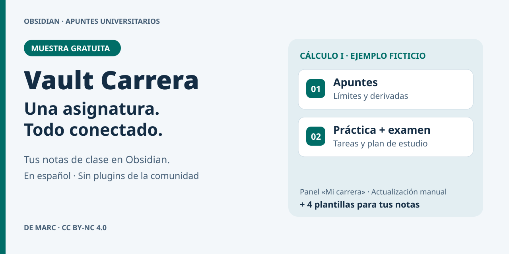

# Vault Carrera — muestra gratuita para Obsidian

Organiza una asignatura técnica en Obsidian con notas conectadas para teoría, prácticas y exámenes. Esta muestra está en español, usa solo Markdown y no requiere plugins de la comunidad.

**[Descargar `vault-carrera-muestra.zip` desde la release](https://github.com/Anim41r0nic/vault-carrera/releases/latest)**. Elige el archivo adjunto con ese nombre; los ZIP automáticos de «Source code» no son la bóveda preparada.

## Contenido

- Una asignatura **ficticia** de Cálculo I, con dos apuntes, una práctica con Python y un parcial.
- `Mi carrera`: panel de fechas y tareas que se **actualiza a mano**.
- Cuatro plantillas: asignatura, apunte, práctica y examen.
- Fórmulas LaTeX y enlaces internos entre notas.

## Instalación en Obsidian

1. Descarga el archivo adjunto `vault-carrera-muestra.zip` de la release y descomprímelo.
2. Abre Obsidian y selecciona **Abrir carpeta como bóveda**. Elige la carpeta extraída `vault-carrera-muestra`, no el ZIP ni su carpeta superior.
3. Abre `README.md`, luego `LEEME.md` y `Mi carrera.md`.
4. Si quieres usar las plantillas: **Ajustes → Plugins principales → Plantillas**. Actívalo y comprueba que su carpeta es `Plantillas`. Después usa **Insertar plantilla** desde la paleta de comandos (`Ctrl+P`).

La muestra no incluye sincronización, temas ni plugins de la comunidad. Es un ejemplo de una asignatura, no una carrera completa.

## Licencia

© 2026 Marc. **CC BY-NC 4.0**: se puede copiar y adaptar con atribución, enlace a la licencia, indicación de cambios y uso no comercial. Consulta el archivo `LICENSE` incluido en el ZIP y el [texto legal de Creative Commons](https://creativecommons.org/licenses/by-nc/4.0/legalcode.es). Tus notas propias son tuyas.
